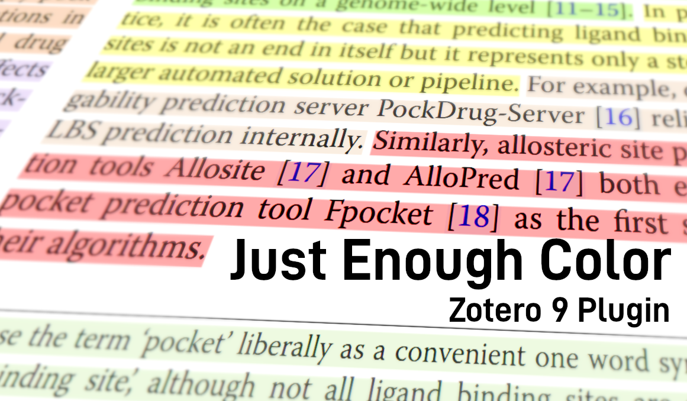

<h1 align="center">Just Enough Color</h1>
<p align="center">
  <b>Colorful highlights & underlines in Zotero</b>
</p>
<p align="center">
  
</p>
<p align="center">
  
  
  
</p>

---

More color in Zotero reader annotations!

## Installation

### From the plugin store

The plugin is available on the [Zotero Chinese plugin store](https://zotero-chinese.com/plugins/) — search "Just Enough
Color" to install.

### From source

```bash
npm ci
npm run build
```

In Zotero: `Tools -> Add-ons -> ⚙️ -> Install Add-on From File…`, choose `build/just-enough-color.xpi`, then restart
Zotero.

## Usage

1. **Random color while selecting text.** Select text in the reader and click the rainbow swatch at the end of the color
   palette (the row with Zotero's 8 stock colors). A highlight/underline is created with a random Morandi color, so you
   can annotate quickly without leaving the text.
2. **Any color for an existing annotation.** Right-click a highlight/underline and choose `Just Enough Color` to
   re-color it. This opens the full picker: Zotero's 8 colors, the strong / light / Morandi presets, recently used
   colors, a system color picker and a hex field.

Custom-colored annotations behave exactly like stock ones: comments, tags, page labels and right-click color switching
all keep working — including together with click-to-translate plugins. The picker marks the annotation's current color,
and the `Just Enough Color` menu entry gets a check mark (✔) when the annotation already uses a custom color.

## Default Colors

| Type                | Rule                                        | Colors                                                                                                                                                                                                                         |
|---------------------|---------------------------------------------|--------------------------------------------------------------------------------------------------------------------------------------------------------------------------------------------------------------------------------|
| Zotero Origin Color | Zotero's built-in palette                    | `["#ffd400", "#ff6666", "#5fb236", "#2ea8e5", "#a28ae5", "#e56eee", "#f19837", "#aaaaaa"]`                                                                                                                                     |
| Strong Color        | `hsl(h, 100%, 50%)`, h = 0, 36, … 324        | `["#ff0000", "#ff9900", "#ccff00", "#33ff00", "#00ff66", "#00ffff", "#0066ff", "#3300ff", "#cc00ff", "#ff0099"]`                                                                                                               |
| Light Color         | `hsl(h, 60%, 78%)`, h = 0, 36, … 324         | `["#e9a5a5", "#e9cea5", "#dbe9a5", "#b3e9a5", "#a5e9c0", "#a5e9e9", "#a5c0e9", "#b3a5e9", "#dba5e9", "#e9a5ce"]`                                                                                                               |
| Morandi Color       | `hsl(h, 25%, 60%)`, h = 0, 18, … 342         | `["#b38080", "#b38f80", "#b39e80", "#b3ad80", "#a8b380", "#99b380", "#8ab380", "#80b385", "#80b394", "#80b3a3", "#80b3b3", "#80a3b3", "#8094b3", "#8085b3", "#8a80b3", "#9980b3", "#a880b3", "#b380ad", "#b3809e", "#b3808f"]`     |

The presets are generated from the HSL rules above (`buildStrongPresets()` / `buildLightPresets()` /
`buildMorandiPresets()` in `src/modules/reader/color-picker.ts`), so the table can be reproduced with any HSL → hex
conversion.

## Features

- Pick any color for a highlight or underline: presets, a system color picker or a hex value.
- Quick random coloring straight from the text-selection popup.
- Custom-colored annotations are real Zotero annotations — comments, tags, page labels and right-click color switching
  keep working.
- Recently used colors are remembered (the 10 most recent picks) and can be viewed or cleared in the settings pane.
- English and Simplified Chinese UI, following Zotero's own language setting.

## Development

```bash
npm ci
npm start          # run Zotero with the plugin loaded (zotero-plugin serve)
npm run typecheck  # tsc --noEmit
npm run build      # build/just-enough-color.xpi
```

## Localization

UI strings live in `addon/locale/<locale>/addon.ftl` ([Fluent](https://projectfluent.org/)) — `en-US` and `zh-CN` ship
with the plugin. To add a language, copy `addon/locale/en-US/addon.ftl` to `addon/locale/<your-locale>/addon.ftl` and
translate the values. Zotero picks the plugin locale closest to the UI locale (exact match → same language → `en-US`),
so a partial translation still falls back per file.

## Compatibility

Zotero 7 or later; developed and tested against **Zotero 10**. The plugin uses the reader's internal annotation manager
(`_internalReader._annotationManager`) to create and re-color annotations, so a future Zotero reader rewrite may require
an update — please report issues with the Zotero version and the debug output (`Help -> Debug Output Logging`).

## License

AGPL-3.0-or-later · Copyright © 2026 MCXCC303
